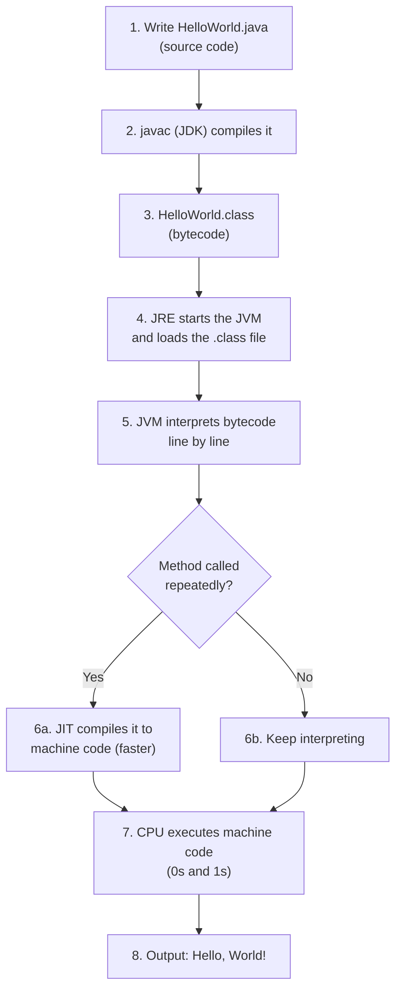

# Java: How Code Runs

## Compilation & Execution

- `.java` file: human-readable source code.
- The compiler (`javac`) converts it into a `.class` file (**bytecode**).
- Bytecode does not run directly on the OS. The **JVM** is required to run it, which makes Java **platform independent**.
- The JVM interprets bytecode into machine code (0s and 1s), line by line.

**Platform independence:** bytecode runs on any OS that has a JVM. Machines only understand 0s and 1s, so the JVM translates for each one.

## JDK vs JRE vs JVM vs JIT

```
┌──────────────────────────────────────────────┐
│ JDK  (Development Kit)                       │
│   javac, debugger, dev tools                 │
│  ┌────────────────────────────────────────┐  │
│  │ JRE  (Runtime Environment)             │  │
│  │   core libraries (System.out, etc.)    │  │
│  │  ┌──────────────────────────────────┐  │  │
│  │  │ JVM  (Virtual Machine)           │  │  │
│  │  │   class loader + interpreter     │  │  │
│  │  │  ┌────────────────────────────┐  │  │  │
│  │  │  │ JIT  (Just-In-Time)        │  │  │  │
│  │  │  └────────────────────────────┘  │  │  │
│  │  └──────────────────────────────────┘  │  │
│  └────────────────────────────────────────┘  │
└──────────────────────────────────────────────┘
```

| Component | Role | Analogy |
|-----------|------|---------|
| **JDK** | Write and compile code (`javac` gives `.class`) | Workshop |
| **JRE** | Run code: JVM + core libraries | Engine room |
| **JVM** | Loads `.class`, converts bytecode to machine code line by line | Interpreter |
| **JIT** | Part of the JVM. Compiles frequently repeated (hot) methods straight to machine code for speed | Shortcut |

> Once compiled, only the JRE is needed to run the program.

## HelloWorld Flow

